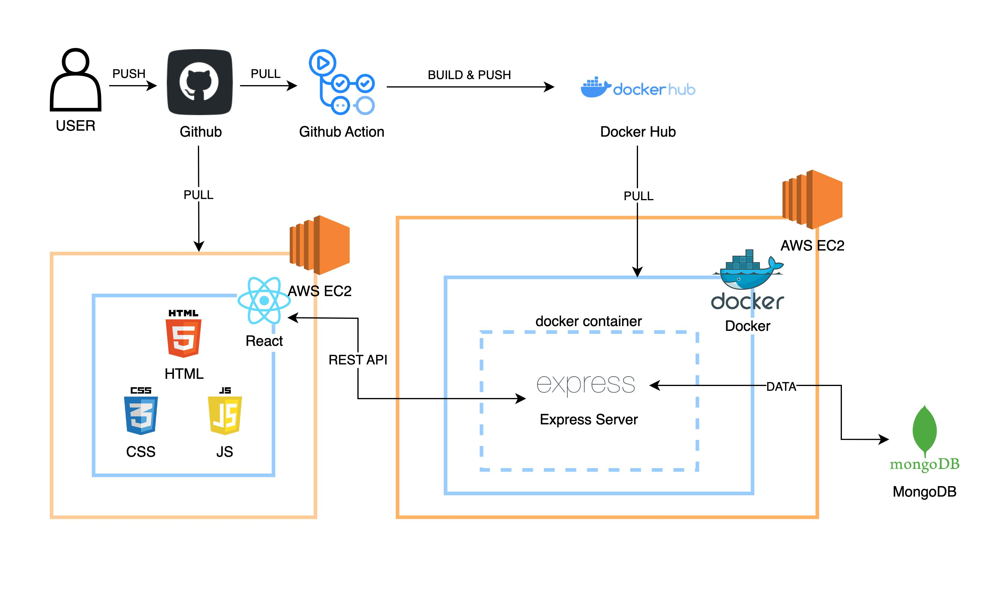

# 📝 Todo List — Multi-Container Application

> A production-ready full-stack application and REST API built with **Node.js**, **Express**, and **MongoDB**, served through **Nginx** as a reverse proxy and static web server — orchestrated with **Docker Compose**.
>
> Project reference: [roadmap.sh/projects/multi-container-service](https://roadmap.sh/projects/multi-container-service)

---

## 🏗️ Architecture



```
                  ┌────────────────────────────────────────────────────────┐
                  │                     Docker Network                     │
  Client ──:80 ──▶│  Nginx (Reverse Proxy & Static Web Host)               │
                  │                         │                              │
                  │                         ├── / ──────▶ Static Frontend  │
                  │                         │             (HTML/CSS/JS)    │
                  │                         ├── /api ───▶ Node.js Express  │
                  │                         │             (:3000)          │
                  │                         └── /health ┘       │          │
                  │                                             └──▶ Mongo │
                  │                                                  (:27017)
                  └────────────────────────────────────────────────────────┘
```

| Container | Image | Role |
|-----------|-------|------|
| `todo_nginx` | `nginx:1.27-alpine` | Reverse proxy on port 80 & static web server serving the frontend UI |
| `todo_app` | Custom (`Dockerfile`) | Express REST API on internal port 3000 with Zod validation & centralized error handling |
| `todo_mongo` | `mongo:7.0` | Persistent MongoDB database with health checks (named volume `mongo_data`) |

---

## 📁 Project Structure

```
Todo-list-Multi-Container/
│
├── docs/
│   └── architecture.jpg        # Architecture diagram
│
├── public/                     # Static Web Frontend
│   ├── index.html              # Responsive web UI
│   ├── style.css               # Modern dark-mode styling
│   └── app.js                  # Frontend client (API interaction & DOM rendering)
│
├── src/
│   ├── config/
│   │   └── db.js               # MongoDB connection
│   ├── controllers/
│   │   └── todoController.js   # CRUD business logic
│   ├── middlewares/
│   │   ├── errorHandler.js     # Centralized error handling middleware
│   │   └── validate.js         # Generic Zod request validation middleware
│   ├── models/
│   │   └── Todo.js             # Mongoose schema
│   ├── routes/
│   │   └── todoRoutes.js       # Express router with validation middleware
│   ├── utils/
│   │   └── AppError.js         # Custom operational application error class
│   ├── validators/
│   │   └── todoValidator.js    # Zod schemas for todo creation and updates
│   └── server.js               # App entry point & health check endpoint
│
├── nginx/
│   └── nginx.conf              # Reverse proxy & static hosting configuration
│
├── Dockerfile                  # Multi-stage production image (node:22-alpine)
├── docker-compose.yml          # Local multi-container orchestration
├── .dockerignore
├── .env.example                # Environment variable template
├── package.json
└── README.md
```

---

## 🚀 Quick Start (Local Development)

### Prerequisites
- [Docker Desktop](https://www.docker.com/products/docker-desktop/) with Docker Compose v2+

### 1. Clone & configure

```bash
cp .env.example .env
```

### 2. Build and run

```bash
docker compose up --build -d
```

### 3. Verify

```bash
# Check containers status & health
docker compose ps

# Open the Web UI in your browser:
# http://localhost

# Test the API
curl http://localhost/api/todos
# Output: {"success":true,"count":0,"data":[]}

# Test the Health check
curl http://localhost/health
# Output: {"status":"ok","uptime":...,"timestamp":"..."}
```

### 4. Stop

```bash
docker compose down            # keeps mongo volume
docker compose down -v         # also clears data volume
```

---

## 🌐 API Reference

Base URL: `http://localhost`

### Endpoints

| Method | Endpoint | Description | Request Body |
|--------|----------|-------------|--------------|
| `GET` | `/` | Web UI (served by Nginx) | — |
| `GET` | `/health` | Service health status | — |
| `GET` | `/api/todos` | List all todos | — |
| `GET` | `/api/todos/:id` | Get a single todo by ID | — |
| `POST` | `/api/todos` | Create a new todo | `{ "title": "...", "description": "..." }` |
| `PUT` | `/api/todos/:id` | Update a todo | `{ "title": "...", "completed": true }` |
| `DELETE` | `/api/todos/:id` | Delete a todo | — |

### Request Validation (Zod)

Requests are strictly validated at the middleware layer using **Zod**:
- **`POST /api/todos`**:
  - `title`: String, required, 1–200 characters (trimmed).
  - `description`: String, optional, max 1000 characters (trimmed).
- **`PUT /api/todos/:id`**:
  - `title`: String, optional, 1–200 characters (trimmed).
  - `description`: String, optional, max 1000 characters (trimmed).
  - `completed`: Boolean, optional.
  - Requires at least one field to update.
- **`:id` parameter**:
  - Must be a valid 24-character hexadecimal MongoDB `ObjectId`.

### Standard Error Responses

Errors are handled uniformly by the centralized error handling middleware:
- **`400 Bad Request`** (Validation error):
  ```json
  {
    "success": false,
    "message": "Validation failed",
    "errors": [
      {
        "field": "body.title",
        "message": "Title is required"
      }
    ]
  }
  ```
- **`404 Not Found`**:
  ```json
  {
    "success": false,
    "message": "Todo not found"
  }
  ```
- **`500 Internal Server Error`**:
  ```json
  {
    "success": false,
    "message": "Internal Server Error"
  }
  ```

---

## 📜 License

MIT
